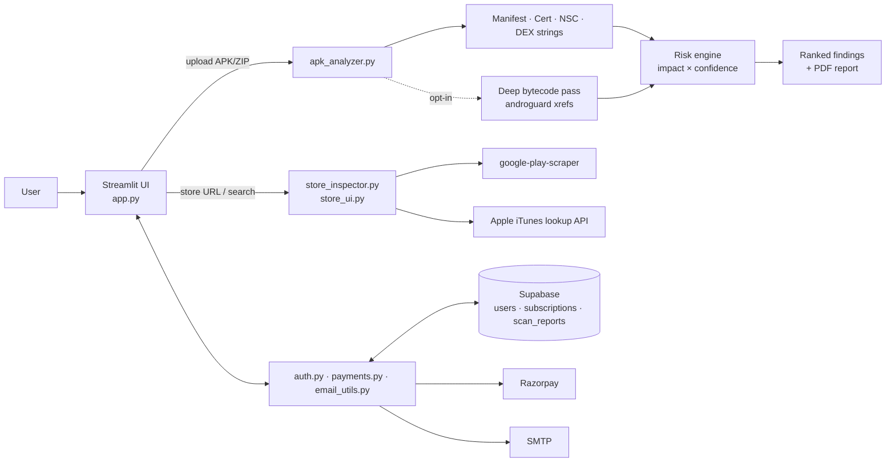

# APKScan MAS — Static Android Security Scanner

[](https://www.python.org/)
[](https://streamlit.io/)
[](LICENSE)

Upload an Android APK and get a ranked list of security findings and an overall risk rating, with a downloadable PDF report. Analysis is **static only**: the app parses the manifest, signing certificate, DEX bytecode and resources. It never installs or runs the APK.

It also looks up **Google Play** and **Apple App Store** listings (public metadata and declared permissions), and includes accounts, scan history and a paid "Pro" pass, so it works as a full web app and not only a scanner.

> **Triage aid, not a malware verdict.** Findings are labelled *confirmed* (a manifest/certificate fact or a traced call site) or *heuristic* (string-pattern presence). Always read the flagged code before drawing conclusions. See [Limitations](#limitations).


## Contents

- [Features](#features)
- [How it works](#how-it-works)
- [Quick start (local)](#quick-start-local)
- [Configuration](#configuration)
- [Database setup (Supabase)](#database-setup-supabase)
- [Accounts, plans and payments](#accounts-plans-and-payments)
- [Using the analyzer as a library](#using-the-analyzer-as-a-library)
- [What it checks](#what-it-checks)
- [Deployment](#deployment)
- [Project structure](#project-structure)
- [Security notes](#security-notes)
- [Limitations](#limitations)
- [Roadmap](#roadmap)
- [License](#license)

## Features

- **Three input modes:** direct upload of an `.apk` or a `.zip` containing APKs (up to 400 MB), a Google Play resolver, and an Apple App Store resolver.
- **Fast pass (always on):** manifest, permission, certificate and Network Security Config parsing, plus string search across the DEX. Usually under a second.
- **Deep bytecode pass (opt-in):** uses [androguard](https://github.com/androguard/androguard) cross-references to trace real call sites and inlined constants. Takes roughly 5 to 60+ seconds depending on app size.
- **Priority ranking:** every finding gets `priority = impact × confidence`, so a confirmed medium finding outranks an unconfirmed high one.
- **Overall risk score:** Low / Medium / High roll-up (a heuristic, not ground truth).
- **Extras:** native library (`.so`) inventory, file entropy report, URL/IP extraction.
- **Reports:** PDF report for APK scans, JSON export for store listings, and a per-user scan history.
- **Accounts:** email + password signup with email verification, admin role, light/dark theme.
- **Monetisation:** 1 free scan, then a 1-day Pro pass via Razorpay (₹59 / $5) with server-side signature verification.

## How it works



End to end, a scan goes like this:

1. The user signs in (a scan requires an account) and uploads an APK or ZIP.
2. The file is written to a temp location; ZIPs have their `.apk` members extracted with path-traversal protection.
3. The scan quota is checked (free: 1 scan; Pro/admin: unlimited).
4. `analyze_apk()` runs the fast pass and, if ticked, the deep pass, then the risk engine ranks the findings.
5. The result is shown in the UI, saved to `scan_reports`, and can be exported as a PDF.
6. Temp files are removed after the scan.

## Quick start (local)

**Requirements:** Python 3.11+ (developed on 3.13), `git`. A Supabase project is needed for login and scan history (see [Database setup](#database-setup-supabase)).

```bash
git clone https://github.com/S-keerthika/apkscan-mas.git
cd apkscan-mas

python3 -m venv venv
source venv/bin/activate          # Windows: venv\Scripts\activate
pip install -r requirements.txt

cp .streamlit/secrets.example.toml .streamlit/secrets.toml
# edit secrets.toml with your Supabase / Razorpay / SMTP values

streamlit run app.py
```

Open <http://localhost:8501>.

Create an admin account (skips email verification and has unlimited scans):

```bash
python create_admin.py
```

## Configuration

Settings are read from `.streamlit/secrets.toml` (the code also falls back to environment variables of the same name, but `secrets.toml` is the tested path). Start from [`.streamlit/secrets.example.toml`](.streamlit/secrets.example.toml).

| Key | Required | Purpose |
|---|---|---|
| `SUPABASE_URL` | yes | Your Supabase project URL |
| `SUPABASE_SECRET_KEY` | yes | Server-side Supabase key. Never expose it to the browser |
| `RAZORPAY_KEY_ID` / `RAZORPAY_KEY_SECRET` | for payments | Use **test** keys until you go live |
| `SMTP_HOST`, `SMTP_PORT`, `SMTP_USER`, `SMTP_PASSWORD` | for signup | Verification emails. Gmail needs an App Password |
| `FROM_EMAIL`, `FROM_NAME` | optional | Sender identity |
| `APP_BASE_URL` | yes in prod | Used to build the verification link, e.g. `https://yourdomain.com` |

UI and upload settings live in [`.streamlit/config.toml`](.streamlit/config.toml) (theme, `maxUploadSize = 400`). `MAX_UPLOAD_MB` in `app.py` must match it.

## Database setup (Supabase)

1. Create a project at [supabase.com](https://supabase.com).
2. In the SQL editor, run [`supabase/schema.sql`](supabase/schema.sql). It creates the three tables the app uses: `users`, `subscriptions` and `scan_reports`.
3. Copy the project URL and key into `secrets.toml`.
4. Enable Row Level Security on all three tables. The app uses a server-side key, so it is not affected, but the tables should not be publicly readable.

## Accounts, plans and payments

| Plan | Scans | Price |
|---|---|---|
| Guest | Browse store listings only | Free |
| Free | 1 APK scan or store resolve | Free |
| Pro (1-day pass) | Unlimited for 24 hours | ₹59 / $5 |


- Passwords are hashed with PBKDF2-HMAC-SHA256 (random salt, 100k iterations).
- New accounts must verify their email before login. Admin accounts created with `create_admin.py` are verified automatically.
- Razorpay checkout redirects back with a payment signature. The app verifies it server-side (`verify_payment_signature`) **before** activating the Pro pass. An expired pass drops back to Free automatically when next checked.

Test the whole checkout with Razorpay test cards before switching to live keys.

## Using the analyzer as a library

`apk_analyzer.py` has no dependency on Streamlit, so you can script it:

```python
from apk_analyzer import analyze_apk

result = analyze_apk("app.apk", "app.apk", deep_scan=True)   # deep_scan=False for a quick pass

print(result.package_name, result.risk_level)
for f in result.ranked_findings()[:10]:
    print(f.priority_score, f.severity, f.confidence, f.title)
```

Each `Finding` has `category`, `severity` (`info|low|medium|high`), `confidence` (`confirmed|…|heuristic`), `title`, `detail`, structured `evidence`, and a computed `priority_score`.

## What it checks

**Structural (from manifest/certificate, confirmed):** `debuggable`, `allowBackup`, cleartext traffic, dangerous permissions and risky combinations (e.g. SMS read + internet), exported activities/services/receivers/providers without a permission guard, self-signed or debug-keystore signing, and Network Security Config that trusts user CAs or allows cleartext per domain.

**Deep bytecode pass (traced call sites):** world-readable/writable files, hardcoded crypto keys/IVs (strings and byte arrays), hardcoded credential fields and map entries, hardcoded secret comparisons (Java and Kotlin), accept-all `TrustManager`, WebView SSL error bypass, SQL built via `StringBuilder`, `Runtime.exec`, `addJavascriptInterface`, tapjacking (missing `filterTouchesWhenObscured`), and native library inventory.

**Presence-based (DEX strings, a signal to go and look):** weak crypto (DES/RC4/ECB), weak hashing (MD5/SHA-1), predictable RNG, dynamic code loading, WebView remote URLs and JavaScript, object deserialization, path traversal strings, cleartext SQLite, temp files, and known secret formats (AWS, Google, GitHub, Slack keys, embedded PEM keys).

Findings are aligned to OWASP MASVS-style categories. The full list of tests, thresholds and how each was validated is in [docs/VALIDATION_LOG.md](docs/VALIDATION_LOG.md).

## Deployment

- **Streamlit Community Cloud / Render / Railway:** push to a **private** GitHub repo, add the secrets in the platform's settings, and point your domain at it. Note that the `razorpay`, `supabase` and `androguard` installs make the build slow on first run.
- **VPS (Ubuntu + nginx + systemd + Let's Encrypt):** full step-by-step in [docs/DEPLOYMENT.md](docs/DEPLOYMENT.md). Shared hosting (cPanel) will **not** work because Streamlit needs a long-running process and WebSockets.

## Project structure

```
apkscan-mas/
├── app.py                  # Streamlit UI, routing, history, pricing, PDF report
├── apk_analyzer.py         # Analysis engine (fast + deep passes, risk engine)
├── store_inspector.py      # Google Play / App Store lookup (no binaries downloaded)
├── store_ui.py             # Store resolver UI
├── auth.py                 # Supabase-backed signup/login/verification
├── payments.py             # Razorpay orders, signature check, plan/quota logic
├── email_utils.py          # SMTP verification emails
├── theme.py                # Styling helpers
├── create_admin.py         # CLI to create an admin account
├── supabase/schema.sql     # Database tables
├── .streamlit/
│   ├── config.toml         # Theme and upload limit
│   └── secrets.example.toml
├── docs/
│   ├── DEPLOYMENT.md
│   └── VALIDATION_LOG.md   # How detectors were tested and tuned
└── requirements.txt
```

## Security notes

This tool parses **untrusted, possibly malicious files**. Before exposing it publicly:

1. **Isolate analysis.** Run androguard in a container or subprocess with CPU, memory and time limits, not inside the web server process.
2. **Validate uploads.** Check magic bytes (not just the extension) and keep the size cap tight.
3. **Rate-limit** uploads. Public scanning endpoints attract abuse.
4. **Protect secrets.** Never commit `.streamlit/secrets.toml` (it is in `.gitignore`). If a key was ever shared or committed, rotate it.
5. **Only scan apps you are authorised to test.**

To report a vulnerability in this project, open a private security advisory on GitHub rather than a public issue.

## Limitations

- Static analysis only: no runtime behaviour, no full taint analysis (it does not prove that attacker-controlled input reaches a sink).
- Native `.so` code is inventoried, not disassembled.
- Heavily obfuscated or string-encrypted apps can hide API names from the string-based checks.
- Fast-pass findings have no per-class attribution, so a hit may come from a bundled third-party SDK rather than the app's own code. The deep pass filters to the app's own package.
- Store lookups use public listing data only. They don't download binaries and don't judge store-policy compliance. iOS IPA analysis is not supported.
- The risk score is a heuristic summary, not a verdict.

## Roadmap

- [ ] Sandbox the analysis step (container/subprocess limits)
- [ ] Automated test suite and CI
- [ ] Hash lookup against a threat-intel source such as VirusTotal
- [ ] Taint analysis for SQL/WebView sinks
- [ ] iOS IPA analysis

## License

[MIT](LICENSE) © 2026 Keerthika Sivakumar

## Acknowledgements

[androguard](https://github.com/androguard/androguard), [Streamlit](https://streamlit.io/), [Supabase](https://supabase.com/), and the intentionally vulnerable apps used for validation: [InsecureBankv2](https://github.com/dineshshetty/Android-InsecureBankv2), [PIVAA](https://github.com/HTBridge/pivaa) and [InsecureShop](https://github.com/hax0rgb/InsecureShop).
